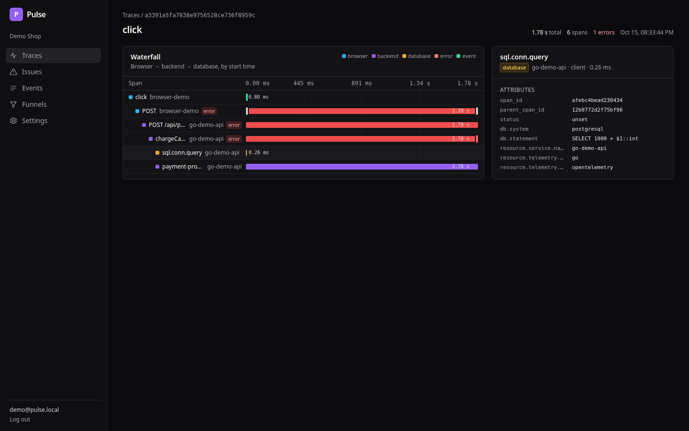
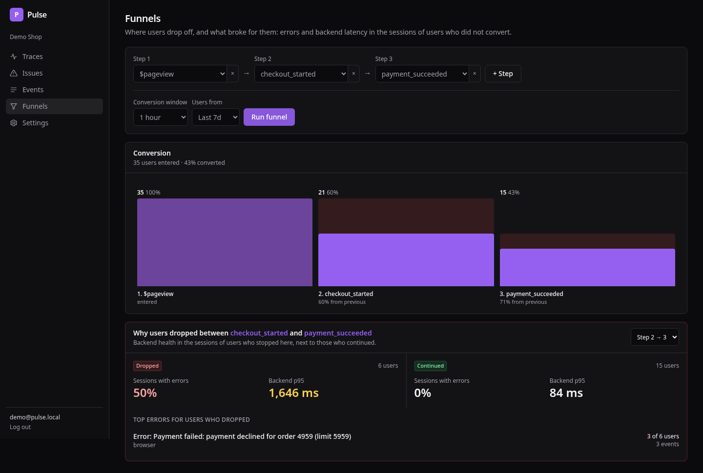
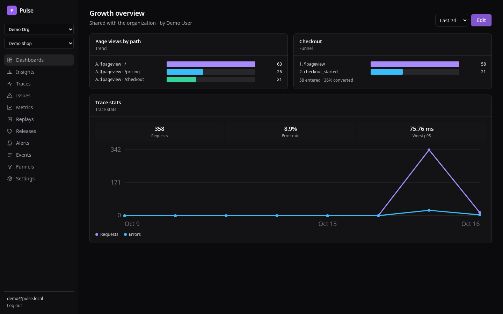
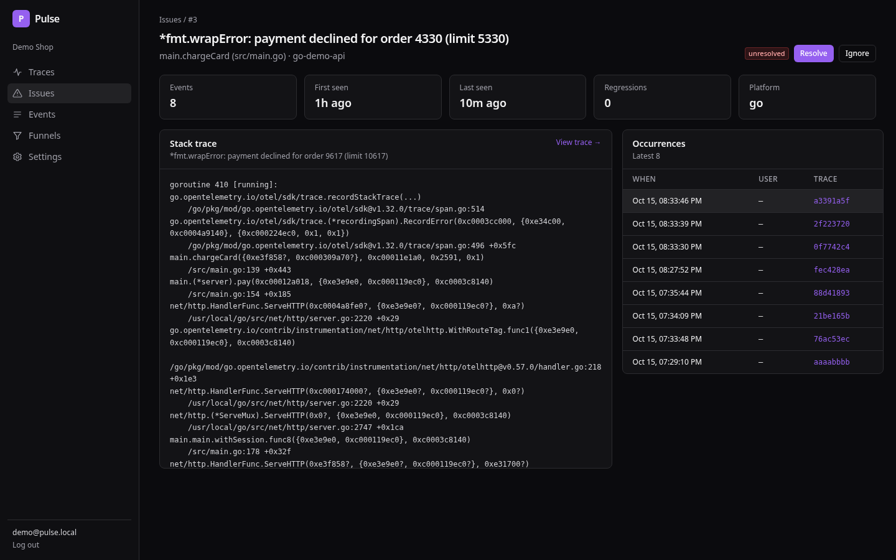
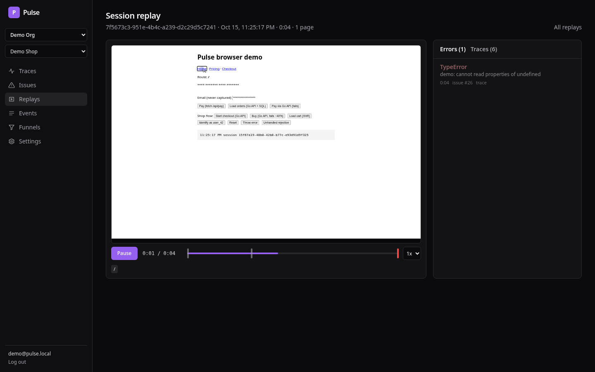

# Pulse

Pulse puts product analytics and observability in one place. Events,
funnels, retention, session replay, traces, logs, metrics and errors share
the same `trace_id`, `session_id` and person. A click in the browser starts an
OpenTelemetry trace that runs through your backend. From a funnel drop-off
you can open the errors, slow requests and replays of the users who left.



| Funnels with the errors of users who dropped | Dashboards |
| --- | --- |
|  |  |
| **Issues with original source and replay links** | **Session replay** |
|  |  |

## Features

- **Product analytics:** events with autocapture, trends with breakdowns
  and formulas, funnels, retention, paths, persons (identify and alias) and
  dashboards.
- **Tracing:** browser and backend spans in one waterfall, trace search,
  service and route stats.
- **Errors:** grouping into issues, source maps for minified stacks,
  regression detection, links to the trace and the replay.
- **Session replay:** rrweb recordings in object storage, linked from
  issues and traces.
- **Logs and metrics:** OTLP logs with search and live tail, OTLP metrics
  with charts.
- **Alerts:** errors, latency, throughput, event counts, new issues and log
  counts, sent to email, Slack or webhooks.
- **Teams and governance:** organizations, roles, invites, an audit log,
  PII scrubbing at ingest, retention periods and person deletion requests.
- **Operations:** Helm chart, Terraform skeleton, Prometheus metrics with a
  Grafana dashboard, load tests and backup scripts.

Everything is received over OpenTelemetry (OTLP over HTTP or gRPC), so any
OTel SDK or Collector can send data. The browser SDK (`@pulse/browser`) adds
product events, autocapture, errors and replay on top of OTel Web.

## Quick start

You need Docker with Compose.

```bash
git clone https://github.com/Mutiur03/pulse && cd pulse
cd deploy/compose && docker compose --profile demo up -d --build --wait
```

Open http://localhost:3000 and log in as `demo@pulse.local` / `pulse-demo`.
To use your own data, sign up or click **New project**. Pulse then shows
your ingest key, an install snippet for the browser, Node.js, Python, Go or
any OTel SDK, and waits until your first event arrives.

To see a full example, `make seed` clicks through the demo shop with real
browsers. That fills traces, events, issues and replays.

| Service | Port |
| --- | --- |
| Web app | 3000 |
| Ingest gateway (OTLP/HTTP, events) | 8080 |
| Ingest gateway (OTLP/gRPC) | 4317 |
| Query API | 8081 |
| Prometheus and Grafana (`--profile monitoring`) | 9090, 3001 |

## Sending data

Browser:

```ts
import { init, capture, identify } from '@pulse/browser';

init({ endpoint: 'http://localhost:8080', apiKey: 'pk_…', serviceName: 'web' });
identify('user_123');
capture('checkout_started', { items: 3 });
```

Backend, with any OpenTelemetry SDK:

```bash
OTEL_EXPORTER_OTLP_ENDPOINT=http://localhost:8080
OTEL_EXPORTER_OTLP_PROTOCOL=http/protobuf
OTEL_EXPORTER_OTLP_HEADERS=X-Pulse-Key=pk_…
```

See [sending backend telemetry](docs/sending-backend-telemetry.md) and
[source maps](docs/source-maps.md).

## Architecture

```
SDKs -> ingest-gateway -> Kafka -> stream-processor -> ClickHouse
                                                     -> Postgres
Web app -> query-api -> ClickHouse, Postgres, object storage
alerting-worker and governance-worker run in the background.
```

The Go services, the Next.js web app and the SDKs live in this monorepo.
The [architecture](docs/architecture.md) document and the
[decision records](docs/adr/README.md) explain the design.

## Documentation

The [documentation index](docs/README.md) lists every guide: using Pulse,
deploying and operating it, and developing it.

## Development

```bash
cd go && go test ./...      # backend
pnpm install && pnpm test   # web app and SDKs
make e2e-web                # Playwright against the compose stack
```

See [development](docs/development.md) for local setup, code generation
and the test suites.

## License

MIT. See [LICENSE](LICENSE).
