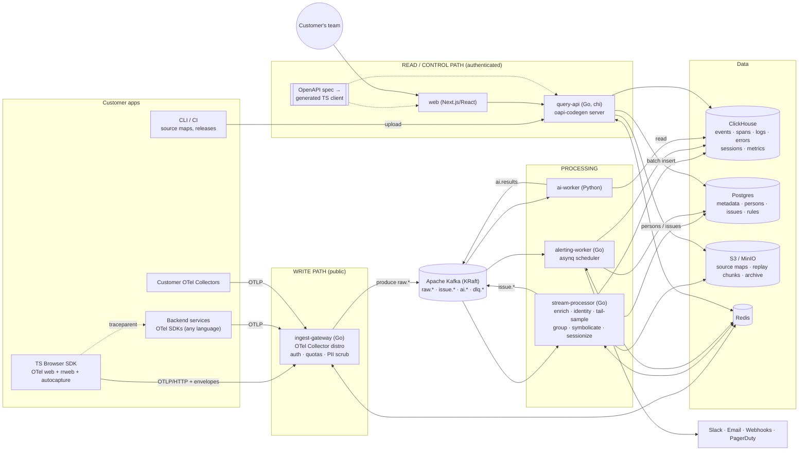
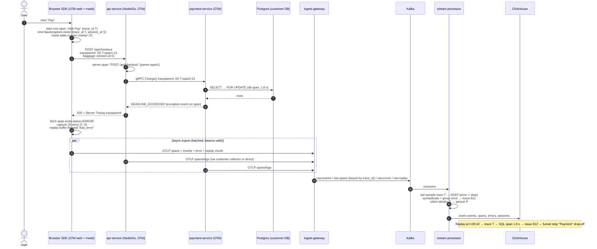

# Unified Product Analytics + Observability Platform — Architecture & Tech Design

**Status:** Draft v4 · **Owner:** Mutiur Rahman · **Date:** 14 Oct 2026

---

## 1. Product vision and core idea

We are building **one platform that replaces three tool categories**:

| Category | Incumbents | What we cover |
|---|---|---|
| Product analytics | GA4, PostHog, Amplitude | Events, autocapture, funnels, retention, paths, cohorts, session replay (rrweb) |
| APM / observability | Datadog, New Relic | Distributed traces, metrics, logs, dashboards, alerts |
| Error tracking | Sentry | Errors, source maps / symbolication, grouping, regressions, releases |

**Core idea: one trace per user action.** A click in the browser starts an OpenTelemetry trace. The W3C `traceparent` header carries that trace through the frontend, the API, downstream services and the database, so every signal shares one `trace_id`. The product event (`$click: Checkout`), the replay frame, the JS or backend error and the slow SQL span all join on `trace_id`, `session_id` and `person_id`. Today that takes three vendors and a lot of manual tab-switching. Here it's a single click.

```
 click "Pay" ──▶ product event ─┐
                 replay frame  ─┤
                 frontend span ─┼── trace_id = 4bf92f35…  ──▶ API span ──▶ payment-svc span ──▶ SQL span (1.8 s)
                 JS error      ─┘        session_id = s_91…            └─▶ exception: TimeoutError
                                         person_id  = p_42…
```

## 2. Goals and principles

- **OTel-native, no lock-in.** We use OTLP wire formats, OTel semantic conventions and plain SQL on ClickHouse. Customers can point any OTel SDK or Collector at us, or take their data with them.
- **Correlation is the product.** Every row in every table carries `project_id`, `trace_id`, `session_id` and `person_id` wherever they apply.
- **100% of product events, smart sampling for traces.** Analytics needs full counts. APM needs the interesting traces.
- **Cheap long retention.** ClickHouse compression plus S3 tiered storage.
- **Privacy by default.** Masking happens in the SDK, scrubbing at the gateway, and tenants are isolated.
- **One codebase.** It self-hosts with **Docker Compose** and scales out with **Kubernetes/Helm**.
- **Don't split into too many microservices.** We run six services. Each exists because it scales differently, has a different security boundary or needs a different runtime.

## 3. Feature scope

**Product analytics**
- Custom and autocaptured events (clicks, form submits, pageviews and page leaves, rage and dead clicks).
- Person and group properties, plus anonymous-to-user identity stitching.
- Insights: trends, **funnels** (ordered, time-windowed, with breakdowns), **retention** (N-day and unbounded), **paths** (Sankey diagrams, start or end at an event), **cohorts** (static, dynamic or behavioral) and stickiness.
- **Session replay** using rrweb, with console logs, network events and a trace link on each request.

**Observability (APM)**
- Distributed traces with a service map, span waterfall and RED metrics per endpoint.
- Metrics: OTLP metrics plus metrics derived from spans and events.
- Logs: OTLP logs, full-text search, live tail and trace correlation.
- Dashboards that mix analytics and APM widgets. Alerts on thresholds, anomalies, error spikes, new issues and funnel conversion drops.

**Errors**
- JS and backend exceptions with stack traces, symbolicated through source maps and debug files.
- Fingerprint grouping into issues, with regression detection and release health.
- Every issue links to the users affected, their replays, their traces and the funnel steps impacted.

## 4. Tech stack

| Layer | Choice | Why |
|---|---|---|
| All backend services: ingest gateway, OTel collector extensions, stream processor, query API, alerting worker | **Go** (one shared Go module) | Fast and low-memory, with predictable GC on high-volume streams. It's the native language of the OTel Collector, ships as a single static binary, and gives one toolchain and one set of shared packages for the whole backend |
| HTTP API (query API) | **chi** (`go-chi/chi`), with Echo as an acceptable alternative | Built on the standard `net/http`, so middleware stays plain Go. Works directly with oapi-codegen's chi server generator |
| API contract | **OpenAPI 3.1, spec-first** (`schemas/openapi/`) → **oapi-codegen** (Go server interfaces + models) and **openapi-typescript + openapi-fetch** (typed TS client for Next.js) | The spec is the single source of truth for the API. The Go handlers must implement the generated strict-server interface, and the web app's TS types are generated from the same spec. Note: oapi-codegen only generates Go code, so a TS generator handles the client side |
| Postgres access | **pgx v5** + **sqlc** | SQL-first with compile-time-checked queries and generated Go types. Migrations use `golang-migrate` |
| ClickHouse access | **clickhouse-go v2** (native protocol, batch inserts) | The official driver. Fast columnar batch inserts for the stream processor and streamed reads for query-api |
| Kafka client | **franz-go** (`twmb/franz-go`) | Pure Go, high throughput, supports transactions and cooperative-sticky rebalancing, actively maintained |
| Alert scheduling | **asynq** (Redis-backed task queue + periodic scheduler) | Periodic rule evaluation, retries and dedup through unique tasks, spread across replicas without leader election |
| Redis client | **go-redis v9** | Shared by gateway quotas, caches, asynq and alert dedup |
| Cross-language message schemas | **Protobuf** (`buf`) | Kafka payloads (`issue.events`, `ai.jobs`) get generated Go and Python types. The web app never reads Kafka, so it needs no proto types |
| Browser SDK | **TypeScript** on **OpenTelemetry JS (web)** + **rrweb** | Built on the standard. Adds autocapture, web vitals, errors, replay and identity |
| Event bus | **Apache Kafka** (KRaft mode, no ZooKeeper) | The industry-standard durable log. Wide operator, managed-service (MSK, Confluent, Aiven) and tooling support |
| Event / telemetry store | **ClickHouse** | Columnar storage with 10–20× compression. Has funnel, retention and window functions built in, plus TTL and S3 tiering |
| Metadata store | **Postgres** | Orgs, projects, users, keys, persons (authoritative), issues, dashboards, alert rules, releases |
| Blob store | **S3** (prod) / **MinIO** (self-host) | Source maps, debug files, replay chunks, raw archive (Parquet) |
| Cache / rate limits / locks | **Redis** | Key cache, quotas, identity cache, symbolication cache, alert dedup |
| Web app | **Next.js / React** (TypeScript) | Insights, replay player, trace explorer, issues, dashboards |
| AI worker | **Python** | Root-cause analysis, issue summaries, natural language to query, semantic grouping assist |

## 5. Services

| # | Service | Lang | Responsibility | Scales on |
|---|---|---|---|---|
| 1 | **ingest-gateway** | Go | Public write endpoint. Takes OTLP/HTTP and OTLP/gRPC, batched SDK envelopes (events, replay chunks) and `sendBeacon`. Validates the project key (cached in Redis), applies rate limits and quotas, scrubs PII, adds server receive time and client IP→geo (IP is then dropped), then produces to Kafka. Ships as an OTel Collector distribution (built with `ocb`) with our custom receivers and processors. | Request rate |
| 2 | **stream-processor** | Go | Kafka consumers running pipeline stages: **enrich** (geo/UA, release, person resolution), **identity stitching**, **sample** (tail sampling for traces), **error grouping** (fingerprinting), **symbolication** (source maps and debug files from S3/MinIO), **sessionization** (session rollups, replay chunk indexing). Batch-writes to ClickHouse, upserts issues and persons in Postgres, and publishes `issue.*`. | Partitions / consumer lag |
| 3 | **query-api** | Go (chi) | The authenticated read and control-plane API. Compiles insights (funnels, retention, paths, cohorts) to ClickHouse SQL. Serves trace, log, error and replay queries. Handles CRUD for projects, dashboards, alerts and cohorts, plus source-map uploads. Enforces RBAC (chi middleware), tenant scoping and query cost limits. It is a modular monolith (ADR 0001): one module per domain under `internal/modules/` (analytics, telemetry, issues, replay, sourcemaps, dashboards, alerts, governance, projects, identity, system), each with domain, service, ports and adapters, and a per-module oapi-codegen interface generated from `schemas/openapi/`. Import boundaries are checked in CI by `internal/archtest`. Reads use clickhouse-go and pgx/sqlc. | Read QPS |
| 4 | **alerting-worker** | Go | Scheduled rule evaluation (a ticker that runs each due rule's ClickHouse query, with a Redis lease per rule so replicas don't double-evaluate; asynq can replace the ticker when rule counts need a queue) plus event-driven rules (`new_issue`, `regression` on `issue.events`) through a franz-go consumer. The metric SQL lives in one shared Go package (`internal/alerts`) that query-api also uses for the rule preview chart, so an alert evaluates exactly what the chart shows. Dedups and throttles in Redis. Notifies email, Slack and signed webhooks (PagerDuty later). | Rule count |
| 5 | **ai-worker** | Python | Root-cause analysis, summaries, near-duplicate grouping suggestions and natural language to query. Read-only access to data. Writes results back through query-api or `ai.results`. | Job queue depth |
| 6 | **web** | Next.js/React | The UI. Talks only to query-api. | Users |

The **TypeScript SDK** (`@pulse/browser`) is a published package, not a service (see §9).

### 5.1 Why the ingest gateway is separate from the query API and web app

The **write path** (ingest-gateway) is a different deployable from the **read and control path** (query-api plus web). We do this on purpose, and it's the one split we never collapse at scale:

1. **Different traffic shape and scaling.** Ingest is high-volume, bursty and write-only, at roughly 10³–10⁶ req/s driven by end users' browsers. Query traffic is low-volume and heavy, at about 10–100 QPS from our customers' staff. Each needs its own HPA signal and node profile: CPU and network for ingest, memory for queries.
2. **Failure isolation.** An expensive funnel query, a bad web deploy or a ClickHouse slowdown must never drop customer telemetry. The gateway only depends on Redis (key cache, falling back to a local cache) and Kafka. Kafka buffers hours of data if ClickHouse or the processors are down. In the other direction, an ingest flood (a viral launch, a client bug in a retry loop) can't starve the dashboards.
3. **Security boundary.** The gateway is a **public, internet-facing endpoint** with permissive CORS, authenticated only by a *publishable* project key that ships in every browser bundle. It has write-only rights and no DB credentials beyond reading the key cache. query-api and web sit behind user sessions, SSO and RBAC, and hold read credentials to all tenant data. Keeping them apart shrinks the blast radius and lets us put different WAF and rate-limit policies on each.
4. **Different SLOs and release cadence.** The gateway targets 99.99% availability and p99 under 50 ms. It changes rarely and gets careful canary rollouts. query-api and web change daily.
5. **Deploy topology.** The gateway can run at the **edge or in each region**, close to end users, for low latency and data residency. Query and web run with the data, in the region's cell.
6. **Protocol fit.** The gateway is an OTel Collector distribution (built with `ocb`), so customers can treat it like any collector. query-api is a chi REST server generated from OpenAPI. Both are Go and live in the same module, but they are different binaries with different dependencies, configs and network exposure. Sharing a language doesn't mean sharing a process.

In Compose self-host mode, all four Go services *can* run as one combined binary (`platform all`), but by default the gateway runs as its own container so that it keeps its public-facing isolation. The code-level boundary (separate `cmd/` entrypoints, no shared in-process state) stays intact either way.

### 5.2 Shared Go module and typed contracts

All Go services live in **one Go module** (`go/go.mod`, module `github.com/Mutiur03/pulse`), with one `cmd/<service>` entrypoint per service and shared code in `internal/`. Benefits: one dependency graph, atomic refactors across services, and no version skew between the shared Kafka, ClickHouse, auth and telemetry packages.

```
schemas/openapi/*.yaml ── oapi-codegen ──▶ go/internal/api/gen (models) + go/internal/modules/<m>/adapters/httpapi/oapi (per-module servers)
        │              ── openapi-typescript ──▶ packages/api-client (TS types + openapi-fetch client) ──▶ apps/web
schemas/postgres/*.sql ── sqlc ──▶ go/internal/store/pg            (pgx v5 typed queries)
schemas/proto/*.proto  ── buf  ──▶ go/internal/proto · workers/ai-worker (Python)
go/internal/insights   ── InsightQuery → ClickHouse SQL, shared by query-api + alerting-worker
```

- **API contract:** every endpoint is defined in the OpenAPI spec. `make generate` runs oapi-codegen (the Go server must implement the interface, or it won't compile) and openapi-typescript (the web app's types). CI fails if the generated code is out of date (`git diff --exit-code`) or if `tsc` breaks, so an API change and its UI impact land in the same PR.
- **Insight definitions:** a funnel, retention or trend is a typed `InsightQuery` object in the OpenAPI spec. The UI builds it with generated TS types. query-api validates and compiles it in `internal/insights`, and alerting-worker reuses the same package unchanged.
- **TypeScript is used only** in `apps/web` (Next.js) and `packages/sdk-browser`. Its backend types come only from the generated client and are never hand-written.
- **Collector dependency weight:** the gateway pulls in large OTel Collector dependencies. To keep this isolated, the `ocb`-generated main lives in `go/cmd/ingest-gateway`. If its dependencies start conflicting with the other services, we split it into a nested module (`go/collector/go.mod`) that imports the shared `internal` packages through a `go.work` workspace, without changing the rest of the layout.

## 6. Services diagram



Text fallback:

```
 Browser SDK ─┐                         (public, write-only)
 OTel SDKs   ─┼── OTLP ──▶ ingest-gateway ──▶ Kafka raw.* ──▶ stream-processor ──▶ ClickHouse
 Collectors  ─┘              │ Redis                            │  │  │            Postgres
                                                                │  │  └──▶ S3/MinIO (replay, maps)
                                                                ▼  ▼
                                               Kafka issue.* ──▶ alerting-worker (Go) ──▶ Slack/Email/PD
                                                             └─▶ ai-worker (Python)
 Customer team ──▶ web (Next.js) ──▶ query-api (Go)  ──▶ ClickHouse / Postgres / S3 / Redis   (authenticated)
                    └── TS types generated from OpenAPI ──┘
```

## 7. Correlation model

| Key | Created by | Lifetime | Carried in |
|---|---|---|---|
| `trace_id` (16 bytes) | SDK at user action, or backend if there's no upstream | One user action | `traceparent` header, every span/log/error/event of that action, replay markers |
| `span_id` | Each component | One operation | Spans, errors, logs (`span_id` column) |
| `session_id` (UUIDv7) | SDK | 30 min of inactivity or 24 h max | Every SDK payload. Propagated to the backend in `baggage: session.id=…` |
| `distinct_id` | SDK (anonymous) or `identify()` | Device / user | Events. Resolved to `person_id` in the stream processor |
| `person_id` | Stream processor | Person | Events, sessions, errors (looked up at write, overridden at query time) |
| `release` / `service.version` | Build | Release | All signals. Selects the right source maps |

**Propagation rules.** The SDK injects `traceparent` (and optionally `tracestate` and `baggage`) only to first-party origins listed in `propagateTraceHeaderCorsUrls`. That avoids CORS preflight failures and leaking IDs to third parties. Backend OTel SDKs continue the trace automatically, and DB client instrumentation emits `db.*` spans. For full page loads, the backend returns `Server-Timing: traceparent;desc="00-…"`, so the document-load span links to the server trace.

## 8. End-to-end request flow



## 9. Frontend SDK design (`@pulse/browser`)

**Size budget:** core under 30 KB gzipped. Replay (rrweb, about 40 KB gzipped) is **lazy-loaded** only when the session is sampled for replay. Work runs in `requestIdleCallback` and compression runs in a Web Worker.

| Module | Design |
|---|---|
| **Tracing (OTel web)** | `WebTracerProvider` with document-load, fetch/XHR and user-interaction instrumentations. Every click or submit that leads to network calls becomes a root span, and route changes create `navigation` spans for SPAs. Uses a `ZoneContextManager`-style async context, or explicit context in frameworks. W3C TraceContext + Baggage propagators, limited to the allowlist. |
| **Autocapture** | One delegated listener on `document` for `click`, `submit` and `change`. Records element chain, tag, classes, `data-attr` / `data-track` and visible text (truncated, masked when sensitive). **Never input values.** Also tracks `$pageview` / `$pageleave` with SPA history patching, rage clicks (3+ in 1 s), dead clicks (no DOM mutation or network within 1 s) and scroll depth. Each event carries the active `trace_id` / `span_id`. |
| **Custom events** | `capture(name, props)`, `group(type, key, props)` and super-properties (`register`). |
| **Web vitals** | Uses the `web-vitals` library to collect LCP, INP, CLS, FCP and TTFB with attribution (LCP element, INP target and phase). Sent as `$web_vitals` events and OTel metrics, with the page's trace and session attached. Long tasks and long animation frames are captured as spans. |
| **Errors** | `window.onerror` and `unhandledrejection`, plus framework integrations (React ErrorBoundary, Vue, Angular). Captures stack, breadcrumbs (last 100 clicks, navigations, network calls and console messages), `release`, and the current `trace_id` / `span_id`. Records the exception on the active span and as an error envelope. |
| **Session replay** | rrweb record with `maskAllInputs: true`, `maskTextSelector` (default: all text in privacy-strict mode), `blockSelector: '.ph-no-capture, [data-private]'`, canvas off, and inline stylesheets cached by hash. Chunks of about 5 s or 64 KB are gzipped in a worker and sent with `session_id` and sequence number. **Trace markers**: `rrweb.addCustomEvent('trace', {trace_id})` on every root span, so the player can jump from a frame to its trace. Supports sampled mode and an **on-error buffer mode** that keeps the last 60 s in memory and uploads only if an error happens. |
| **Identity** | Generates an anonymous `distinct_id` (UUIDv7) and stores it in first-party storage (localStorage, with a cookie fallback, configurable or cookieless). `identify(userId, traits)` emits `$identify` with `$anon_distinct_id`, and `reset()` on logout. `alias()` is supported. Cross-subdomain cookie is optional. |
| **Batching / offline** | In-memory queue that flushes at 50 items, 5 s or `visibilitychange: hidden` (via `sendBeacon` / `fetch keepalive`). Payloads are gzipped (`CompressionStream`). When offline, it persists to IndexedDB (capped at 5 MB, FIFO) and retries with exponential backoff and jitter. Respects `429 Retry-After`. Each event has an idempotency key `uuid` for dedup at the server. |
| **Privacy** | Consent API (`optIn/optOut`, wait-for-consent mode), Do Not Track respected (configurable), URL query and fragment allowlist (strips `token`, `code`, `email`…), `beforeSend` hook, and attribute redaction. Never sends cookies or Authorization headers in network capture. Request and response bodies are off by default. |
| **Transport** | OTLP/HTTP JSON for spans and metrics, and a compact envelope for events, errors and replay. Everything goes to a single gateway origin, which can be proxied by the customer's own domain to avoid ad-blockers. |

```ts
import { init } from '@pulse/browser';
init({
  projectKey: 'pk_live_…',
  endpoint: 'https://ingest.example.com',        // or first-party proxy
  release: process.env.GIT_SHA,
  propagateTraceHeaderCorsUrls: [/^https:\/\/api\.myshop\.com/],
  autocapture: true,
  replay: { sampleRate: 0.1, onErrorSampleRate: 1.0, maskAllText: false },
  tracing: { sampleRate: 1.0 },              // tail sampling decides server-side
  privacy: { respectDNT: true, stripQueryParams: ['token', 'email'] },
});
```

**Backend side:** we don't build our own server SDKs at first. We publish thin "distros" (presets) of the official OTel SDKs for Node, Go, Python, Java and .NET. They add exception capture with local variables where possible, a `baggage`→span attribute processor (copies `session.id` and `user.id` onto spans), and DB statement sanitization. Any vanilla OTel SDK still works.

## 10. Identity stitching (anonymous → user)

**Model** (PostHog-style). A *person* has many `distinct_id`s. Events are stored with the `distinct_id` they were sent with, plus the `person_id` resolved when they were written. Merges are applied **retroactively at query time** through an override table, so old anonymous events count toward the identified user in funnels and retention.

1. A first visit generates `anon_A`. Events have `distinct_id = anon_A`, and the stream processor creates person `P1` with mapping `anon_A → P1`.
2. On login, `identify('user_42')` sends `$identify {distinct_id: user_42, $anon_distinct_id: anon_A}`.
3. The stream processor (keyed by project, holding a Redis lock per distinct_id):
   - If `user_42` is unknown, map `user_42 → P1`. No merge is needed.
   - If `user_42` already maps to `P2` (another device) and `anon_A` is still anonymous, **merge**: `anon_A → P2`, and write an override `P1 → P2` (version++).
   - **Guard:** never merge two *identified* persons automatically, since that's the classic shared-device bug. Merge only when the anonymous side has never been identified. Explicit `alias()` can override this.
4. Postgres is authoritative (`persons`, `person_distinct_ids`). Changes are mirrored into ClickHouse `person_overrides` (ReplacingMergeTree by `version`). Queries resolve with `if(o.new_person_id != '', o.new_person_id, e.person_id)` through a join or dictionary.
5. A nightly squash job rewrites `person_id` on recent partitions and truncates overrides, which keeps the joins small.
6. Backend correlation: `baggage user.id` / `session.id` stamps backend spans, so server-side errors also attribute to the person.
7. `reset()` on logout starts a new anonymous id, so the next user on a shared device isn't merged in.

## 11. Ingest and Kafka topics

| Topic | Producer | Consumers | Partition key | Notes |
|---|---|---|---|---|
| `raw.events` | ingest-gateway | stream-processor | `project_id:distinct_id` | Keeps per-user ordering for identity |
| `raw.spans` | ingest-gateway | stream-processor (tail sampler) | **`trace_id`** | All spans of a trace land on one consumer |
| `raw.logs`, `raw.metrics` | ingest-gateway | stream-processor | `project_id` | |
| `raw.errors` | ingest-gateway | stream-processor | `project_id` | Symbolicate → group |
| `raw.replay` | ingest-gateway | stream-processor | `session_id` | Chunk → S3, index → ClickHouse |
| `issue.events` | stream-processor (from the issue outbox) | alerting-worker, the analysis worker | `issue_id` | new / regressed / resolved |
| `ai.jobs` / `ai.results` | query-api / ai-worker | ai-worker / query-api | `job_id` | |
| `dlq.*` | all | ops tooling | — | Poison messages, replayable |

Kafka settings: `acks=all`, `min.insync.replicas=2` and RF=3 in prod (RF=1 in Compose), lz4/zstd compression, and 24–72 h retention on `raw.*` as a replay buffer. Consumers use cooperative-sticky rebalancing and commit offsets only after the ClickHouse batch insert succeeds. Inserts are idempotent through `insert_deduplication_token`, so delivery is at-least-once with dedup.

## 12. Storage: ClickHouse schema (examples)

All tables lead the sort key with `project_id` (tenant isolation and pruning), are partitioned by day or month, carry a TTL per retention tier, and move to S3 through the `tiered` storage policy.

```sql
-- Product analytics events (100% kept)
CREATE TABLE events
(
    project_id      UInt64,
    uuid            UUID,                               -- client idempotency key
    event           LowCardinality(String),             -- '$pageview', '$autocapture', 'checkout_started'
    timestamp       DateTime64(3, 'UTC'),
    distinct_id     String,
    person_id       UUID,
    session_id      String,
    trace_id        FixedString(32) DEFAULT '',
    span_id         FixedString(16) DEFAULT '',
    properties      JSON,                               -- ClickHouse native JSON type
    current_url     String MATERIALIZED properties.`$current_url`::String,
    elements_chain  String,                             -- autocapture element path
    release         LowCardinality(String),
    country         LowCardinality(String),
    browser         LowCardinality(String),
    os              LowCardinality(String),
    inserted_at     DateTime DEFAULT now(),
    INDEX idx_trace trace_id TYPE bloom_filter(0.01) GRANULARITY 4,
    INDEX idx_sess  session_id TYPE bloom_filter(0.01) GRANULARITY 4
)
ENGINE = ReplacingMergeTree(inserted_at)                -- dedup by uuid on merge
PARTITION BY toYYYYMM(timestamp)
ORDER BY (project_id, event, toDate(timestamp), person_id, uuid)
TTL toDateTime(timestamp) + INTERVAL 30 DAY TO VOLUME 'cold',
    toDateTime(timestamp) + INTERVAL 25 MONTH DELETE
SETTINGS storage_policy = 'tiered';

-- Distributed trace spans (tail-sampled), OTel-compatible column names
CREATE TABLE spans
(
    project_id      UInt64,
    timestamp       DateTime64(9, 'UTC'),
    trace_id        FixedString(32),
    span_id         FixedString(16),
    parent_span_id  FixedString(16),
    span_name       LowCardinality(String),
    span_kind       Enum8('INTERNAL'=0,'SERVER'=1,'CLIENT'=2,'PRODUCER'=3,'CONSUMER'=4),
    service_name    LowCardinality(String),
    duration_ns     UInt64,
    status_code     Enum8('UNSET'=0,'OK'=1,'ERROR'=2),
    status_message  String,
    http_route      LowCardinality(String),
    http_status     UInt16,
    db_system       LowCardinality(String),
    db_statement    String CODEC(ZSTD(3)),             -- sanitized (no literals)
    session_id      String,
    person_id       UUID,
    resource_attrs  Map(LowCardinality(String), String),
    span_attrs      Map(LowCardinality(String), String),
    events          Nested(ts DateTime64(9), name LowCardinality(String), attrs Map(LowCardinality(String), String)),
    sample_rate     Float32 DEFAULT 1,                 -- for re-weighting counts
    INDEX idx_trace trace_id TYPE bloom_filter(0.001) GRANULARITY 1,
    INDEX idx_dur   duration_ns TYPE minmax GRANULARITY 1
)
ENGINE = MergeTree
PARTITION BY toDate(timestamp)
ORDER BY (project_id, service_name, span_name, toStartOfHour(timestamp), timestamp)
TTL toDateTime(timestamp) + INTERVAL 7 DAY TO VOLUME 'cold',
    toDateTime(timestamp) + INTERVAL 30 DAY DELETE
SETTINGS storage_policy = 'tiered';

-- trace_id → time range lookup (fast "open trace")
CREATE TABLE trace_index
(
    project_id UInt64, trace_id FixedString(32),
    start SimpleAggregateFunction(min, DateTime64(9)),
    end   SimpleAggregateFunction(max, DateTime64(9))
) ENGINE = AggregatingMergeTree ORDER BY (project_id, trace_id)
  TTL toDateTime(start) + INTERVAL 30 DAY;
CREATE MATERIALIZED VIEW trace_index_mv TO trace_index AS
SELECT project_id, trace_id, min(timestamp) AS start, max(timestamp) AS end
FROM spans GROUP BY project_id, trace_id;

-- Logs
CREATE TABLE logs
(
    project_id     UInt64,
    timestamp      DateTime64(9, 'UTC'),
    trace_id       FixedString(32) DEFAULT '',
    span_id        FixedString(16) DEFAULT '',
    severity       LowCardinality(String),
    service_name   LowCardinality(String),
    body           String CODEC(ZSTD(3)),
    attrs          Map(LowCardinality(String), String),
    resource_attrs Map(LowCardinality(String), String),
    INDEX idx_body  body TYPE tokenbf_v1(32768, 3, 0) GRANULARITY 1,
    INDEX idx_trace trace_id TYPE bloom_filter(0.01) GRANULARITY 4
)
ENGINE = MergeTree
PARTITION BY toDate(timestamp)
ORDER BY (project_id, service_name, severity, toStartOfHour(timestamp), timestamp)
TTL toDateTime(timestamp) + INTERVAL 3 DAY TO VOLUME 'cold',
    toDateTime(timestamp) + INTERVAL 15 DAY DELETE
SETTINGS storage_policy = 'tiered';

-- Error occurrences (issue state itself lives in Postgres)
CREATE TABLE errors
(
    project_id     UInt64,
    event_id       UUID,
    timestamp      DateTime64(3, 'UTC'),
    issue_id       UInt64,
    fingerprint    FixedString(32),
    platform       LowCardinality(String),           -- 'javascript', 'go', 'python'…
    exception_type LowCardinality(String),
    message        String,
    frames         Nested(function String, module String, filename String,
                          lineno UInt32, colno UInt32, in_app UInt8),  -- symbolicated
    release        LowCardinality(String),
    environment    LowCardinality(String),
    trace_id       FixedString(32) DEFAULT '',
    span_id        FixedString(16) DEFAULT '',
    session_id     String,
    person_id      UUID,
    url            String,
    tags           Map(LowCardinality(String), String),
    INDEX idx_trace trace_id TYPE bloom_filter(0.01) GRANULARITY 4
)
ENGINE = MergeTree
PARTITION BY toYYYYMM(timestamp)
ORDER BY (project_id, issue_id, timestamp)
TTL toDateTime(timestamp) + INTERVAL 90 DAY DELETE;

-- Sessions (one row per session, folded incrementally)
CREATE TABLE sessions
(
    project_id       UInt64,
    session_id       String,
    person_id        SimpleAggregateFunction(any, UUID),
    distinct_id      SimpleAggregateFunction(any, String),
    started_at       SimpleAggregateFunction(min, DateTime64(3)),
    ended_at         SimpleAggregateFunction(max, DateTime64(3)),
    pageviews        SimpleAggregateFunction(sum, UInt32),
    events           SimpleAggregateFunction(sum, UInt32),
    errors           SimpleAggregateFunction(sum, UInt32),
    rage_clicks      SimpleAggregateFunction(sum, UInt32),
    entry_url        AggregateFunction(argMin, String, DateTime64(3)),
    exit_url         AggregateFunction(argMax, String, DateTime64(3)),
    has_replay       SimpleAggregateFunction(max, UInt8),
    replay_bytes     SimpleAggregateFunction(sum, UInt64),
    trace_ids        SimpleAggregateFunction(groupUniqArrayArray, Array(FixedString(32))),
    country          SimpleAggregateFunction(any, LowCardinality(String)),
    browser          SimpleAggregateFunction(any, LowCardinality(String))
)
ENGINE = AggregatingMergeTree
PARTITION BY toYYYYMM(started_at)
ORDER BY (project_id, toDate(started_at), session_id)
TTL toDateTime(started_at) + INTERVAL 25 MONTH DELETE;

-- Replay chunk index (payloads live in S3: replay/{project}/{session}/{seq}.json.gz)
CREATE TABLE replay_chunks
(
    project_id UInt64, session_id String, seq UInt32,
    first_ts DateTime64(3), last_ts DateTime64(3),
    s3_key String, bytes UInt32, has_error UInt8,
    trace_ids Array(FixedString(32))
) ENGINE = ReplacingMergeTree ORDER BY (project_id, session_id, seq)
  TTL toDateTime(first_ts) + INTERVAL 30 DAY DELETE;

-- Identity overrides for retroactive merges
CREATE TABLE person_overrides
(
    project_id UInt64, old_person_id UUID, new_person_id UUID, version UInt64
) ENGINE = ReplacingMergeTree(version) ORDER BY (project_id, old_person_id);
```

**Metrics.** OTLP metrics land in `metrics_sum`, `metrics_gauge` and `metrics_histogram` tables (following the ClickHouse OTel exporter schema). Materialized views roll them up to 1-minute and 1-hour buckets, and the 1-hour rollups are kept for 13 months. RED metrics per service and route are **derived from 100% of spans before sampling** in the stream processor, so latency and error-rate charts stay exact even though stored traces are sampled.

**Example: funnel drop-off explained by errors and latency.**

```sql
WITH funnel AS (
  SELECT person_id,
         windowFunnel(3600)(timestamp, event = 'cart_viewed', event = 'checkout_started',
                                       event = 'payment_submitted', event = 'order_completed') AS step,
         argMaxIf(session_id, timestamp, event = 'payment_submitted') AS sess
  FROM events
  WHERE project_id = {p:UInt64} AND timestamp >= now() - INTERVAL 7 DAY
  GROUP BY person_id)
SELECT
  countIf(step = 3)                                                    AS dropped_at_payment,
  countIf(step = 3 AND e.session_id != '')                             AS with_error,
  countIf(step = 3 AND s.p95_ms > 2000)                                AS with_slow_backend,
  topKIf(3)(e.issue_id, step = 3)                                      AS top_issues
FROM funnel
LEFT JOIN (SELECT session_id, any(issue_id) AS issue_id FROM errors
           WHERE project_id = {p:UInt64} AND timestamp >= now() - INTERVAL 7 DAY GROUP BY session_id) e
       ON e.session_id = funnel.sess
LEFT JOIN (SELECT session_id, quantile(0.95)(duration_ns)/1e6 AS p95_ms FROM spans
           WHERE project_id = {p:UInt64} AND span_kind = 'SERVER' AND timestamp >= now() - INTERVAL 7 DAY
           GROUP BY session_id) s
       ON s.session_id = funnel.sess;
```

Retention uses `retention()`, paths use `groupArray` plus `arrayJoin` windows over `$pageview` / `$screen` events, and cohorts are materialized into `cohort_people` (ReplacingMergeTree, refreshed incrementally) so they can be used as filters.

## 13. Sampling strategy

| Signal | Policy |
|---|---|
| **Product events** | **100%, never sampled.** Funnels, retention and billing need exact counts. Abuse is handled by quotas and bot filtering, not sampling. |
| **Traces** | SDKs export 100% of spans (head `sampleRate=1.0` by default, configurable). **Tail sampling in the stream-processor**: `raw.spans` is partitioned by `trace_id`. A per-trace buffer waits 30 s after the last span, up to 2 min, then decides. Keep **100%** of traces with any error span, traces whose root or server span exceeds the per-route p95 or an SLO threshold, traces linked to a session with replay or to a funnel event the customer marked "important", and traces touched by a new release in its first hour. Keep a **5–10% baseline** of everything else, consistent by `trace_id` hash so frontend and backend parts agree. Dropped traces still feed RED metrics (computed before sampling). Kept spans store `sample_rate` so counts can be re-weighted. |
| **Errors** | 100% up to a per-issue rate limit (e.g. 1,000/min per issue). Above that, keep 1-in-N and record the counts. |
| **Session replay** | Session-level: `sampleRate` (e.g. 10%) plus `onErrorSampleRate` (100%, from the 60 s rolling buffer). Can be forced on for cohorts, URLs or flags. |
| **Logs** | 100% ingested within quota. Debug logs can be dropped by gateway rules, and exact-duplicate bursts are collapsed. |
| **Metrics** | No sampling. Cardinality limits per metric (e.g. 10k series) with overflow bucketing. |

At scale, tail-sampler state lives in the consumer's memory, sharded by partition. If a consumer crashes, Kafka replays from the last committed offset, and decisions are idempotent. A dedicated trace-sampling consumer group could become its own deployment later (see §19).

## 14. Privacy and PII scrubbing

**Layered defense:**
1. **SDK (never collected):** masked inputs, optional text masking, blocked elements, no input values in autocapture, URL parameter stripping, no request bodies by default, consent gating.
2. **Gateway (scrubbed before durable storage):** regex and Luhn detectors for emails, cards, IBANs, phone numbers, JWTs, bearer tokens and AWS keys. Applied to event properties, span attributes, log bodies and error messages. Rules can be configured per project. `Authorization`, `Cookie` and `Set-Cookie` headers are always dropped. IP addresses are turned into geo, then truncated or discarded, with a per-project setting.
3. **Stream processor:** `db.statement` sanitization (literals → `?`, per OTel semconv) as a safety net when the customer's SDK hasn't done it, plus replay DOM text checks for leaked PII patterns.
4. **Storage and access:** encryption at rest (ClickHouse disks, S3 SSE-KMS) and TLS everywhere. RBAC with a "can view replays" permission. Audit log of who viewed which replay.
5. **Data-subject rights:** a GDPR/CCPA delete by `person_id` runs a ClickHouse lightweight `DELETE` (events, errors, sessions), removes S3 replay prefixes and Postgres rows, and is tracked as a job with an SLA (≤30 days). There's also a person data export.
6. **Residency:** EU and US cells with data pinned to a region (§15). A cookieless or anonymous mode skips persistent identifiers.

## 15. Multi-tenancy

- **Hierarchy:** organization → project → environment. `project_id` is the tenant key in every table and Kafka message.
- **Isolation in ClickHouse:** `project_id` comes first in every `ORDER BY`. query-api **always** injects the project predicate from the auth context, and users never send raw SQL with table access. For the SQL editor feature, a ClickHouse **row policy** is applied through a per-request setting, as an extra safeguard.
- **Noisy neighbors:**
  - Per-project ingest quotas and token buckets in Redis at the gateway.
  - Per-project query limits through ClickHouse settings profiles (`max_execution_time`, `max_bytes_to_read`, `max_concurrent_queries_for_user`).
  - A query priority queue in query-api.
  - Kafka keys spread the hot tenants across partitions.
- **Cells:** each region is a full stack (Kafka, ClickHouse, Postgres, S3, services). A thin global control plane handles signup, billing and routing. Very large tenants can get a **dedicated ClickHouse cluster or database** in the same cell, with no code changes, by routing on `project_id`.
- **Self-host** is single-tenant by default, but the same multi-project model applies.

## 16. Retention tiers and cost

| Tier | Storage | Events | Spans | Logs | Errors | Replay | Metrics (rollups) |
|---|---|---|---|---|---|---|---|
| **Hot** | ClickHouse NVMe | 30 d | 7 d | 3 d | 90 d | index | 1-min: 15 d |
| **Cold** | ClickHouse S3 disk (tiered, queryable, slower) | to 25 mo | to 30 d | to 15 d | — | — | 1-h: 13 mo |
| **Replay blobs** | S3 Standard → IA after 7 d | — | — | — | — | 30 d (90 d paid) | — |
| **Archive** | S3 Parquet (Glacier IR) | optional, years | optional | optional | — | — | — |

Plans adjust the TTLs per project (per-project TTL columns or a separate table set for enterprise). The archive can be **rehydrated** into a temporary ClickHouse table on demand, and customers can query it directly from their own warehouse, so there's no lock-in.

**Cost model (planning assumptions; validate in load tests):**
- Compressed bytes per row in ClickHouse: events about 60–120 B, spans about 80–150 B, logs about 30–80 B (10–20× compression on repetitive telemetry).
- 1 B events/month ≈ about 100 GB compressed. 1 B spans/month (after tail sampling) ≈ about 120 GB. S3 cold storage at about $0.023/GB-month means **long retention costs pennies per million events**.
- The main cost drivers are compute for ClickHouse inserts and merges and the replay S3 egress. Mitigations: large batched inserts (≥10k rows or 1 s), async inserts in Compose, ZSTD codecs, replay served through a CDN with signed URLs.
- **Goal:** infrastructure cost at or below **$0.05 per 1k replay sessions**, **$0.01 per 1M events stored per month (cold)**, and **≤$0.10 per GB of logs ingested**. Pricing is usage-based with generous free tiers, and an "unlimited retention on cold" upsell.
- Cost controls for customers: quotas, sampling knobs, drop rules at the gateway, per-signal usage dashboards and budget alerts.

## 17. Alerting, dashboards and AI

- **Dashboards** mix widgets from any source (trend, funnel, retention, trace RED chart, log count, error count) with shared filters (release, country, cohort). Widgets compile to ClickHouse SQL through query-api, and results are cached in Redis with a TTL.
- **Alerts:** thresholds and anomalies on any insight (including "funnel conversion dropped 20% vs last week"), new or regressed issues, SLO burn rate, log patterns. alerting-worker evaluates on a schedule, dedups, groups and snoozes.
- **AI root cause (ai-worker):** given an issue, a funnel drop or an alert, it collects the correlated context: top stack frames, the matching slow spans and SQL, the deploy or release diff, affected cohorts, and replay summaries (DOM event digest, never raw PII). It then produces a ranked hypothesis with links to the evidence (trace IDs, replay timestamps). It never acts on its own. The model provider is pluggable (any compatible chat-completions endpoint or a local model for self-host), runs on the customer's own data only, and is opt-in per org.

## 18. How we beat GA4 / PostHog / Datadog / Sentry

| Differentiator | What it means concretely | Incumbent gap |
|---|---|---|
| **Funnel drop-off explained by errors and latency** | Every funnel step shows "*38% of users who dropped at Payment hit issue #812 or saw p95 > 2 s on `POST /api/checkout`*". Click through to those sessions. | GA4/PostHog show *that* users drop, not *why* technically. Datadog and Sentry don't know about funnels. |
| **Replay → trace → query drilldown** | In the replay player, every network request and click links to its trace waterfall, down to the exact SQL span and the backend log lines. And in reverse, from a slow query to the replays it affected. | PostHog replay stops at the browser. Sentry replay links only to Sentry traces. Datadog RUM is tied to Datadog's agent and pricing. |
| **One identity across all signals** | `person_id` shows up on errors, spans and logs through baggage. "Show me everything that happened to customer X yesterday" is one timeline. | Each incumbent has its own user model. Joining them takes manual work. |
| **OTel-native, no lock-in** | OTLP in, standard semconv, the official OTel SDKs on the backend, ClickHouse tables you can query with SQL, and a Parquet archive export. Self-host with the same code. | Datadog relies on proprietary agents and its own pricing units. GA4 offers limited raw access (only via BigQuery export). |
| **Cheap long retention** | ClickHouse compression plus S3 tiering: 25-month event history and 13-month metrics by default, with ingest-based pricing and no per-host or "indexed span" charges. | Datadog charges separately for ingested and indexed data, with short default retention. Sentry and PostHog charge per event or recording volume. |
| **AI root cause on correlated data** | The AI sees the frontend error, backend span, SQL, deploy and affected funnel together, so it can say "*the deploy at 14:02 added an N+1 query in `OrderRepo.load`; 1,240 users dropped at checkout*". | Single-signal AI assistants see only part of the picture. |
| **Privacy-first replay and analytics** | Strict masking by default, EU cell, cookieless mode, a self-host option. | GA4 faces ongoing regulatory scrutiny in the EU. |
| **One SDK, one bill** | A single browser SDK replaces the gtag, PostHog, Sentry and Datadog RUM snippets. That means fewer KB on the page and one consent flow. | Customers run 3–4 snippets today. |

**Positioning:** "*The PostHog of observability, with real backend tracing*", i.e. product teams and engineers working on the same data. We start with mid-market SaaS and e-commerce teams who are paying for both PostHog/GA4 and Datadog/Sentry.

## 19. Repository layout (monorepo)

```
/
├─ go/                     # ONE Go module: github.com/Mutiur03/pulse
│  ├─ go.mod
│  ├─ cmd/
│  │  ├─ ingest-gateway/   # OTLP/HTTP, OTLP/gRPC and SDK envelope intake → Kafka
│  │  ├─ stream-processor/ # enrich, identity, tail-sample, group, symbolicate, sessionize
│  │  ├─ query-api/        # composition root: wires and mounts the modules
│  │  ├─ alerting-worker/  # rule ticker, franz-go consumer, notifiers
│  │  ├─ governance-worker/ # retention and deletion requests
│  │  ├─ pulse-cli/        # source-map inject and upload
│  │  └─ platform/         # combined binary for small self-host (`platform all`)
│  └─ internal/
│     ├─ ingest/           # gateway handlers: auth, quota, scrubbing, OTLP decoding
│     ├─ processor/        # stream-processor stages
│     ├─ insights/         # InsightQuery → ClickHouse SQL (query-api + alerting-worker)
│     ├─ api/gen/          # shared OpenAPI models (generated)
│     ├─ modules/          # query-api modules: domain, service, ports, adapters, module.go
│     ├─ store/ch/         # clickhouse-go wrappers, batch writer
│     ├─ kafka/            # franz-go producer/consumer helpers
│     ├─ archtest/         # import boundary checks for the modules
│     └─ auth/ orgs/ audit/ alerts/ governance/ config/ telemetry/ …
├─ workers/ai-worker/      # Python (uv, FastAPI health + Kafka consumer)
├─ apps/web/               # Next.js / React (replay player, insights, trace explorer)
├─ packages/               # TypeScript only (pnpm + Turborepo)
│  ├─ sdk-browser/         # @pulse/browser – SDK on OTel web + rrweb
│  ├─ api-client/          # @pulse/api-client – generated from schemas/openapi (openapi-typescript + openapi-fetch)
│  └─ vite-plugin/         # @pulse/vite-plugin – source-map upload at build time
├─ schemas/
│  ├─ openapi/             # OpenAPI 3.1 spec – source of truth for query-api + TS client
│  ├─ postgres/            # SQL migrations
│  └─ clickhouse/          # ClickHouse DDL migrations
├─ deploy/
│  ├─ compose/             # docker-compose.yml for self-host
│  ├─ helm/                # one chart for all services
│  ├─ migrate/             # migration runner image
│  ├─ monitoring/ staging/ terraform/
├─ examples/               # browser and Go demo apps
├─ load/                   # k6 load tests
└─ tools/                  # smoke tests, backup scripts
```

Tooling: the **Go module** in `go/` covers all backend services, with `golangci-lint` and `go test ./...`. A single `make generate` runs oapi-codegen and the TypeScript client generator. **pnpm workspaces + Turborepo** cover only `apps/web` and `packages/*`, with `@pulse/api-client` regenerated from the spec as a Turborepo task the web build depends on. uv covers Python. A single CI pipeline uses path filters (a change under `schemas/openapi/` triggers both the Go and web jobs), checks that generated code is up to date, and produces one image per service from the same Go module (multi-stage `CGO_ENABLED=0` builds on distroless), with a shared version tag.

## 20. Deployment

**Self-host (Docker Compose).** One `docker compose up` runs:
- all 6 services;
- **Apache Kafka** (single broker, KRaft mode, RF=1);
- ClickHouse (single node);
- Postgres, Redis and MinIO.

The AI worker is optional (Compose profile `ai`). For small installs, the Go services can run as **one combined binary** (`platform all`), or as gateway + `platform` (processor, API, alerting), so the stack shrinks to 3 app containers (ingest-gateway, platform, web) plus the optional AI worker. Minimum footprint: about 4 vCPU and 16 GB RAM for about 5M events/day.

**At scale (Kubernetes/Helm).** An umbrella chart, one cell per region:
- **ingest-gateway:** HPA on CPU/RPS, behind its own L7 load balancer and WAF on a separate hostname (`ingest.`). Can run on edge or regional clusters.
- **stream-processor:** KEDA on Kafka consumer lag, with replicas ≤ partitions. Separate consumer groups per topic family (events, spans, errors, replay) so each can scale independently from the same image.
- **query-api and web:** HPA on CPU, on their own hostname (`app.`), behind SSO.
- **alerting-worker:** a few replicas running asynq workers (tasks spread across them through Redis), with one asynq scheduler (via asynq's `PeriodicTaskManager` with unique tasks, so duplicate enqueues are harmless). A franz-go consumer group handles event-driven rules.
- **ai-worker:** KEDA on `ai.jobs` lag. GPU nodes optional.
- **Kafka:** the **Strimzi** operator (KRaft), or a managed service (Amazon MSK, Confluent Cloud, Aiven). RF=3, rack-aware.
- **ClickHouse:** Altinity operator or ClickHouse Cloud, sharded by `project_id` hash and replicated through ClickHouse Keeper.
- **Postgres, Redis and S3:** managed services.

## 21. Why not more services?

Enrichment, identity, sampling, grouping, symbolication and sessionization stay as **stages inside stream-processor**, run as separate consumer groups from one binary. Splitting them into separate services would add serialization hops and extra topics without scaling any better. Metadata CRUD lives in query-api for the same reason. The only boundaries we enforce are write vs read (§5.1), Python for AI, and server (Go) vs UI (TypeScript). The alerting worker is its own deployable only so that scheduled evaluation doesn't compete with interactive queries. It shares `internal/insights` with query-api and is folded into `platform all` for small installs.

First candidates to pull out, only once metrics show the need:
1. **Symbolication**: CPU and memory spikes, large caches.
2. **Tail sampler**: stateful, memory-heavy.
3. **Replay ingestion**: high bandwidth.

## 22. Observability of the platform itself

Every service self-instruments with OTel and exports to an internal project on a *separate* cell. We dogfood the product, but we can't be blind when the cell itself is down. Key signals: gateway accept/reject rate and p99, Kafka consumer lag per group, ClickHouse insert latency, parts count and merges, tail-sampler buffer size, DLQ rate, and query p95 per insight type.

## 23. Phased roadmap

| Phase | Timeline | Scope | Exit criteria / milestones |
|---|---|---|---|
| **0 — Foundations** | Weeks 0–6 | Monorepo, Compose stack (Kafka KRaft, ClickHouse, Postgres, Redis, MinIO), ingest-gateway (OTLP + events), stream-processor skeleton, schemas, auth/projects, CI | `docker compose up` ingests OTLP spans and events end to end. 10k events/s on one node. |
| **1 — MVP: "one trace per click"** | Months 2–4 | Browser SDK (OTel web, autocapture, errors, web vitals, batching/offline), errors with source maps and grouping, traces explorer + waterfall, basic event trends, `trace_id` linking event ↔ error ↔ span, Next.js UI | 5 design partners live. Clicking a JS error opens the full frontend→backend→DB trace. SDK under 30 KB gzipped. |
| **2 — v1: Product analytics + replay** | Months 4–7 | Session replay (rrweb, masking, on-error mode, trace markers), identity stitching, funnels, retention, paths, cohorts, dashboards, alerts (issues + thresholds), tail sampling, PII scrubbing, retention tiers | Public beta and cloud launch (US cell). "Funnel drop-off explained" shipped. 100k events/s per cell. |
| **3 — v1.5: Full observability** | Months 7–10 | Logs (search, live tail), OTLP metrics + rollups, service map, SLOs, anomaly alerts, AI root cause + NL→query, EU cell, usage billing, SSO/RBAC/audit | GA. 3 customers have replaced Datadog or Sentry. Average time to root cause cut 50% vs their baseline. |
| **4 — v2+: Platform** | Months 10–18 | Mobile SDKs (iOS/Android via OTel + replay), feature flags & experiments tied to traces, warehouse export / Parquet archive + rehydration, data pipelines (CDP destinations), dedicated tenant clusters, HA self-host Helm, SOC 2 Type II | SOC 2 done, 1M events/s per cell, enterprise self-host customers. |

## 24. Key risks

| Risk | Impact | Mitigation |
|---|---|---|
| **Scope:** competing with three mature product categories | Shipping a mediocre version of everything | Lead with the *correlation* wedge (MVP = errors + traces + events), then expand. Match the 80% features, not full parity. |
| **ClickHouse operations at scale** (merges, parts explosion, replication) | Ingest backpressure, outages | Large batched inserts, async inserts, alerting on parts per partition, Altinity operator or ClickHouse Cloud, runbooks. |
| **Stateful tail sampling** | Memory pressure, incomplete traces on rebalance | Bounded buffers, decision cache, partition by `trace_id`, graceful fallback to probabilistic sampling. |
| **SDK performance / size** | Customers reject the SDK, hurts web vitals | Strict budgets in CI, lazy replay, worker compression, real-device perf tests. |
| **`traceparent` CORS breakage** | Customers' API calls fail on preflight | Allowlist-only propagation, docs plus a "check headers" diagnostic, staged rollout. |
| **Privacy / legal (replay PII, GDPR, ePrivacy)** | Regulatory and trust damage | Masking by default, scrubbing layers, EU cell, DPA, audit logs, deletion SLAs, DPIA templates. |
| **Identity merge errors** | Corrupted funnels and retention | Merge guards, override table (reversible), merge audit log, test suite of edge cases. |
| **High-cardinality metrics / attributes** | Cost blowups | Cardinality limits, attribute allowlists, overflow buckets, usage dashboards. |
| **Ad-blockers blocking ingest** | Data gaps | First-party proxy / CNAME guide, neutral endpoint paths. |
| **Incumbent response / funded competitors** (PostHog, Datadog, ClickStack) | Pricing pressure | Open-source core + self-host, correlation UX as the moat, price on cheap retention. |
| **AI cost and hallucination** | Wrong root cause, margin erosion | Evidence-linked answers only, confidence scores, caching, per-org budgets, opt-in. |
| **API contract drift** between the Go backend and the Next.js UI | Runtime errors in the UI | Spec-first OpenAPI, generated Go server interfaces and TS client, CI check that generated code is current, contract tests against the spec. |
| **Single Go module dependency conflicts** (heavy OTel Collector deps) | Upgrade friction | Pin Collector versions, use Renovate grouping. Move the gateway into a nested module with `go.work` if conflicts appear (§5.2). |
| **Kafka operational overhead for small self-hosters** | Install friction | Single-broker KRaft defaults, tuned small configs, managed-Kafka option documented. |

## 25. Prior art and references

| Project | What we learn / reuse | Difference from us |
|---|---|---|
| **SigNoz** (signoz.io, github.com/SigNoz/signoz) | OTel-native APM on ClickHouse, Go, OTel Collector-based ingestion, trace/log/metric schemas | No product analytics, funnels or replay. |
| **HyperDX / ClickStack** (github.com/hyperdxio/hyperdx, clickhouse.com/docs/clickstack). ClickHouse acquired HyperDX in March 2025. | Session replay correlated with logs and traces on ClickHouse, a browser SDK that extends OTel JS with `tracePropagationTargets` | Focus on observability. No funnels, retention or cohorts, no person model. |
| **PostHog** (github.com/PostHog/posthog) | ClickHouse + Kafka event pipeline, person / distinct_id model with overrides, rrweb replay, autocapture, insight SQL (funnels, retention, paths) | Analytics-first. Backend APM / distributed tracing isn't its core. |
| **Sentry** (github.com/getsentry) | Error grouping/fingerprinting, `symbolicator`, source-map handling, replay on-error buffer mode | Proprietary SDK protocol (now OTel-compatible in parts). Not an analytics tool. |
| **OpenTelemetry** (opentelemetry.io) | JS web SDK, W3C TraceContext/Baggage, semantic conventions, Collector (`ocb`), `tail_sampling` processor, ClickHouse exporter | — |
| **rrweb** (github.com/rrweb-io/rrweb) | DOM record/replay, masking options, custom events | — |
| Also: OpenReplay, Highlight.io, Grafana LGTM, Jaeger, `web-vitals` | Replay + devtools UX, OSS observability patterns | — |

## 26. Open questions

- Store replay chunks in ClickHouse (like ClickStack) or S3 with a ClickHouse index (current plan)? We'll benchmark cost and player latency.
- Should the person-on-events squash run nightly or be continuous?
- Do we expose a raw SQL editor in v1 (needs row policies), or only in v1.5?
- AI worker: hosted model vs bring-your-own-key as the default for cloud?
- Licensing for the open-source core (MIT vs AGPL vs source-available for enterprise features)?
